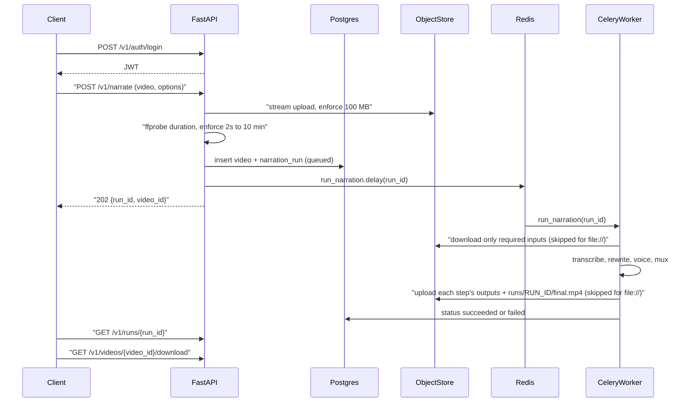
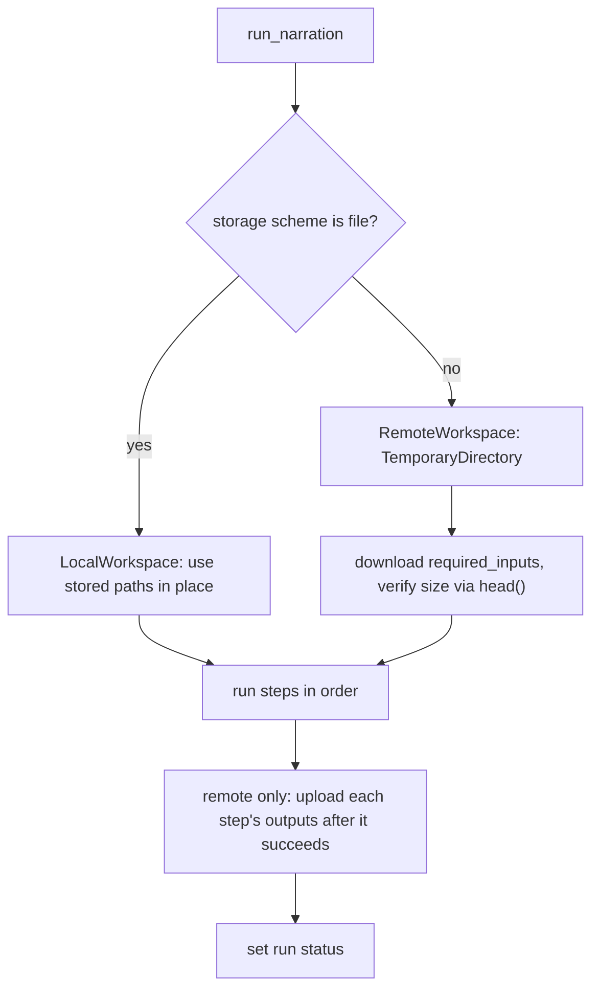

# FastAPI, uv, JWT auth, and the narration pipeline API

## Endpoints (all under `/v1`)

- `POST /v1/auth/signup`: takes a JSON body with `email` and `password`. Returns 201 with a `UserResponse` (`id`, `email`, `created_at`), or 409 if the email already exists.
- `POST /v1/auth/login`: takes an OAuth2 password form where `username` holds the email. Returns `{access_token, token_type: "bearer"}`, or 401 on bad credentials. Using the form keeps the Swagger "Authorize" button working.
- `POST /v1/narrate` (requires a JWT): takes `multipart/form-data` with these fields:
  - `video`: required, `.mov` or `.mp4`.
  - `model`, `voice`, `max_atempo`: optional overrides, the same as the old CLI flags.
  - Upload and validation run **synchronously in the HTTP request**. Celery is used only for the pipeline after validation succeeds (see "Upload validation" below).
  - Limits: max **100 MB**, duration between **2 seconds** and **10 minutes**.
  - On success it creates a `video` row and a `narration_run` with all four steps, then returns 202 with a `RunResponse` (`run_id`, `video_id`, `status`, `steps`).
  - Errors on the same request: 415 for a bad file type, 413 if the upload exceeds 100 MB, 422 if duration is out of range or the media is unreadable.
- `POST /v1/retry` (requires a JWT): takes a JSON body `{video_id, steps?, model?, voice?, max_atempo?}`.
  - If `steps` is omitted, all of `transcribe`, `rewrite`, `voice`, `mux` run. Steps always run in pipeline order, and the listed steps are forced to re-run.
  - Any option you leave out takes the value from the latest run for that video.
  - Returns 202 with a `RunResponse`. Returns 409 if a run for that video is already `queued` or `running`, and 404 or 403 if the video is missing or not yours.
  - No video upload and no size/duration checks; those were already applied on the original `/v1/narrate`.
- `GET /v1/runs/{run_id}` (requires a JWT): returns `status` (`queued`, `running`, `succeeded`, `failed`), `current_step`, `error`, and timestamps.
- `GET /v1/videos/{video_id}/download` (requires a JWT): finds the latest `succeeded` run for the video whose `steps` include `mux`, then streams `final_key(video_id, run_id)`. Returns 404 if no such run exists yet.

Versioning: `src/main.py` builds `api_v1 = APIRouter(prefix="/v1")`, includes the auth and narration routers in it, and then includes `api_v1` in the app. A later `/v2` gets its own aggregator router.



## Naming rule: no "demo" in source

The source tree contains no identifier, table, column, class, module, or config key containing "demo".

- `DemoPaths` becomes `WorkPaths`, and `resolve_demo_dir` becomes `resolve_workdir`.
- The step functions are renamed `transcribe_video`, `rewrite_script`, `generate_voice`, `mux_video`.
- `DEMOS_DIR` is replaced by `STORAGE_URL`.
- The `demo_mgr` package is deleted.
- Only the repo name stays, as `name = "demo-narrator"` in `pyproject.toml`, because it is project metadata rather than code.

## Project layout (domain-based, following AGENTS.md)

```
src/
  main.py            # FastAPI app, /v1 aggregator router, docs hidden outside local/staging
  config.py          # Global settings: ENVIRONMENT, DATABASE_URL, CELERY_BROKER_URL
  database.py        # SQLModel metadata with POSTGRES_INDEXES_NAMING_CONVENTION, async + sync engines
  models.py          # Shared base model (UUID pk, created_at)
  exceptions.py
  worker.py          # Celery app
  storage/   config.py service.py           # obstore wrapper; no router
  auth/      router.py schemas.py models.py service.py dependencies.py config.py exceptions.py utils.py
  narration/ router.py schemas.py models.py service.py dependencies.py config.py constants.py exceptions.py tasks.py
             pipeline/  # moved from demo_mgr/: transcribe.py rewrite.py tts.py mux.py align.py chunks.py paths.py ffmpeg_util.py
migrations/          # alembic init -t async
tests/
```

- Move the step modules into `src/narration/pipeline/`, rename them per the rule above, and replace the `os.getenv` reads (GROQ_API_KEY, GROQ_MODEL, WHISPER_MODEL, DEFAULT_VOICE) with `narration_settings`.
- Delete [demo_mgr/](demo_mgr/), including `cli.py`, `__main__.py`, and the `__pycache`__ folders, and delete [requirements.txt](requirements.txt).
- `narration/constants.py` defines `NarrationStep(StrEnum)` and `ALL_STEPS`, plus `RunStatus(StrEnum)`.

## Data model (singular snake_case tables)

- `user`: `id` (UUID), `email` (unique), `hashed_password`, `created_at`
- `video`: `id` (UUID), `user_id` (UUID, FK → `user.id`), `original_filename`, `source_ext` (`mov` or `mp4`), `created_at`
- `narration_run`: `id` (UUID), `video_id` (UUID, FK → `video.id`), `steps` (JSON), `options` (JSON), `status`, `current_step`, `error`, `created_at`, `started_at`, `finished_at`

All primary keys and foreign keys are UUID. No storage keys or paths are stored in the database. Every key is built in code from `video_id`, `source_ext`, and `run_id` (see "Key layout" below).

## Storage: local in dev, Supabase or S3 in production (config only)

- Library: [obstore](https://developmentseed.org/obstore/). It is a Rust-backed Python binding for the `object_store` crate, with both async and sync APIs and Python 3.15 wheels already published. `obstore.store.from_url(url, **options)` picks the backend from the URL scheme, so switching from local to cloud is only an environment change.
  - Local dev: `STORAGE_URL=file:///app/storage`, which is a bind mount shared by the API and the worker.
  - Production: `STORAGE_URL=s3://<bucket>`. Supabase Storage exposes an S3-compatible endpoint, so set `STORAGE_S3_ENDPOINT=https://<project>.supabase.co/storage/v1/s3`, `STORAGE_S3_REGION`, `STORAGE_S3_ACCESS_KEY_ID`, and `STORAGE_S3_SECRET_ACCESS_KEY`. The same settings work for AWS S3, Cloudflare R2, or MinIO.
- `StorageConfig(BaseSettings)` uses the `STORAGE_` prefix. `storage/service.py` exposes:
  - async functions for the API: `put_stream(key, chunks, *, max_bytes)`, `open_stream(key)`, `exists(key)`, `delete(key)`
  - sync functions for the worker: `is_local()` (true when the `STORAGE_URL` scheme is `file`), `local_path(key)`, `download(key, dest_path)` (streams to disk, then checks the size), `upload(src_path, key)`, `upload_dir(src_dir, prefix)`, and `delete(key)` (succeeds if the key is already gone)
  - No `open()` runs inside `async def`. Uploads stream the `UploadFile` chunks straight into `obstore.put_async`. `put_stream` counts bytes and raises `UploadTooLarge` when the count would exceed `max_bytes`; the caller then deletes any partial object.
- Key layout, defined in a single module, `narration/utils.py`. No other code builds keys or paths by hand:

```python
VIDEO_PREFIX = "videos"

def video_prefix(video_id: UUID) -> str: ...                  # videos/{video_id}
def source_key(video_id: UUID, source_ext: str) -> str: ...   # videos/{video_id}/source.{ext}
def work_key(video_id: UUID, name: str) -> str: ...           # videos/{video_id}/work/{name}
def final_key(video_id: UUID, run_id: UUID) -> str: ...       # videos/{video_id}/runs/{run_id}/final.mp4
```

- `work/` holds `audio.wav`, `transcript.json`, `script.json`, `clips/`, `narration.wav`, and `sync-report.json`. These are the latest intermediates, so `/v1/retry` can start at any step.
- `work/` is shared by all runs of a video on purpose: it always holds the latest state, and each retry builds on it.
- `runs/{run_id}/final.mp4` is written once per run that includes `mux`. Only the newest `NARRATION_KEEP_FINALS` finals are kept (see "Final output retention" below).
- Changing the layout later, for example renaming `videos/` to `assets/`, is a code change plus a one-off script that copies the existing objects to the new prefix. Object stores have no rename, so the script copies each object and then deletes the old one.
- Download streams through the API with `StreamingResponse` over `obstore.get_async(...).stream()`, which behaves the same for both backends.

## Key implementation choices

- **Auth**:
  - Passwords are hashed with `pwdlib[argon2]` and JWTs use PyJWT (HS256).
  - `AuthConfig` uses the `AUTH_` prefix: `AUTH_JWT_SECRET`, `AUTH_JWT_ALG`, `AUTH_JWT_EXP_MINUTES`.
  - `CurrentUserDep = Annotated[User, Depends(get_current_user)]` uses `OAuth2PasswordBearer(tokenUrl="/v1/auth/login")`, and future routers can reuse it.
- **DB**:
  - SQLModel with psycopg v3 works in two modes. The API uses async (`postgresql+psycopg://` with `create_async_engine`), and the Celery worker uses a sync session from the same URL.
  - A `valid_owned_video` dependency raises 404 if the video is missing and 403 if another user owns it. The run status and download routes reuse it.
- **Route style**:
  - Routes that touch the DB or storage are `async def`, and route signatures use `Annotated`.
  - Each route declares a return type, `status_code`, `summary`, and a `responses` map for its error codes.
  - Each router sets its own prefix and tags.
  - Blocking work inside `async def` (for example `ffprobe`, sync service calls) uses Asyncer `asyncify(...)`, never a second copy of the function and never nested `asyncio.run` inside a running loop.

## Sync core shared by FastAPI and Celery

Business logic is written once as sync Python. FastAPI and Celery only differ at thin I/O adapters. Do not create `*_async` / `*_sync` twins of the same SQL or pipeline logic.

```text
shared sync core
  auth/service.py, narration/service.py
  narration/pipeline/* , narration/utils.py (keys)
  narration workspaces, required_inputs, prune_finals, run_steps

thin adapters only
  database.py     get_async_session / get_sync_session (same models)
  storage/service.py   async put_stream/open_stream vs sync download/upload/delete
```

Rules:

- Service functions take a sync `Session` (or no session) and are plain `def`. Examples: `create_video_and_run`, `mark_run_running`, `run_steps`, `prune_finals`.
- Celery `run_narration(run_id)` opens a sync session and calls those services and the pipeline directly. No `asyncio.run` around the whole task (Edge TTS already uses `asyncio.run` inside `generate_voice`).
- FastAPI `async def` routes: stream uploads and downloads with the async storage helpers; for sync services and `ffprobe`, call `await asyncify(service_fn)(...)`.
- Models, schemas, enums, and storage key helpers are shared. Only session open/commit and obstore put/get have separate sync and async entrypoints, and those entrypoints share private helpers for byte counting and size checks.

## Upload validation on `POST /v1/narrate`

Upload stays on the API request. Celery starts only after validation succeeds.

1. Check the filename extension is `.mov` or `.mp4`. Reject with **415** otherwise. Do not create a DB row yet.
2. Allocate a `video_id`, then stream the body into storage at `source_key(video_id, ext)` through `put_stream(..., max_bytes=NARRATION_MAX_UPLOAD_BYTES)`. Count bytes as chunks arrive. If the count would exceed **100 MB**, abort the stream, `delete` any partial object, and return **413**.
3. Probe duration with `await asyncify(probe_duration)(...)` (same approach as today's `probe_duration`):
   - On `file://`, probe `local_path(source_key(...))` directly.
   - On remote storage, download the source into a short-lived `TemporaryDirectory`, probe that file, then delete the temp dir. (Presigned URL probing is out of scope.)
4. If duration is under **2 seconds**, over **10 minutes**, or unreadable, `delete` the stored object and return **422**. Do not create a run.
5. Insert the `video` and `narration_run` rows via `await asyncify(create_video_and_run)(session, ...)`, enqueue `run_narration.delay(run_id)`, and return **202**.

Proxy and load-balancer idle timeouts should allow at least 60–120 seconds so a full 100 MB upload on a slow link does not get cut off. The minutes-long narration work still runs only on Celery.

## Celery task `narration.run_narration(run_id)`

See "Worker file handling" below. The task is a thin sync wrapper: open a sync session, load the run, call shared `narration.service` and pipeline functions. Run status flow:

- It sets `running` at the start and updates `current_step` before each step. Each requested step is forced to re-run.
- When every step finishes, it sets `succeeded`. If the run included `mux`, it then prunes old finals (see "Final output retention").
- It records `failed` with the error message when it catches one of the specific exceptions: `FileNotFoundError`, `RuntimeError` (including `FFmpegError`), `StorageIntegrityError`, or OpenAI or Groq errors.
- Task settings: `acks_late=True` and no automatic retries, because users retry through `/v1/retry`.

## Worker file handling

### Download only what the requested steps need

`narration/constants.py` declares the files each step reads and writes. The entries match the current code in `demo_mgr/`.

- `transcribe`: reads `source`; writes `audio.wav`, `transcript.json`, `script.json`
- `rewrite`: reads `script.json`; writes `script.json`
- `voice`: reads `script.json`; writes `clips/`, `narration.wav`, `sync-report.json`, `script.json`. It also needs `source` when `script.json` has no `video_duration` (the fallback in `align.py`).
- `mux`: reads `source`, `narration.wav`; writes `final.mp4`

`narration/service.py` exposes `required_inputs(steps)`. It walks the steps in pipeline order and collects every file a step reads that no earlier step in the same run writes. Examples:

- A first run of all four steps needs only `source`.
- A retry of `[voice, mux]` needs `script.json` and `source`, not `narration.wav`, because voice writes it.
- A retry of `[mux]` needs `source` and `narration.wav`.
- A retry of `[rewrite]` needs only `script.json`.

If a required file is missing from storage, the run fails before any step starts, with a message such as "Missing script.json. Run transcribe first."

### Two workspaces, chosen by `STORAGE_URL` alone



- `**LocalWorkspace` (`file://`)**: makes no copies.
  - The source path is `local_path(source_key(video_id, source_ext))`, and the step working folder is `local_path(work_key(video_id, ""))`. Both go to ffmpeg, Whisper, and pydub as they are.
  - Mux writes straight to `local_path(final_key(video_id, run_id))`.
- `**RemoteWorkspace` (`s3://`, Supabase, `memory://` in tests)**:
  - Creates a `TemporaryDirectory`, then downloads each key in `required_inputs(steps)` once. The source is downloaded at most once per run, even when both transcribe and mux use it.
  - After each step succeeds, it uploads that step's outputs under `work_key(video_id, ...)`, so a later failure still leaves usable files for `/v1/retry`.
  - Uploads `final.mp4` to `final_key(video_id, run_id)`.
- **Size check**:
  - `storage.download()` streams the object to disk with `obstore.get(...)` and reads the expected size from `obstore.head(...)`.
  - It raises `StorageIntegrityError` if the size on disk differs. The check applies to every downloaded file, including the source.
- Both workspaces give the pipeline the same `WorkPaths` object (`source`, `audio`, `transcript`, `script`, `clips_dir`, `narration`, `sync_report`, `final`), so the step functions don't know which backend is in use.

### Final output retention

- `NarrationConfig` (prefix `NARRATION_`) includes:
  - `KEEP_FINALS: int = Field(default=2, ge=1)` via `NARRATION_KEEP_FINALS=2`
  - `MAX_UPLOAD_BYTES: int = Field(default=104_857_600)` via `NARRATION_MAX_UPLOAD_BYTES` (100 MB)
  - `MAX_DURATION_SECONDS: int = Field(default=600)` via `NARRATION_MAX_DURATION_SECONDS` (10 minutes)
  - `MIN_DURATION_SECONDS: int = Field(default=2)` via `NARRATION_MIN_DURATION_SECONDS`
- After a run that included `mux` is marked `succeeded`, the worker calls `prune_finals(video_id)` in `narration/service.py`:
  - It queries `narration_run` for that video where `status = succeeded` and `steps` contain `mux`, ordered by `finished_at` descending.
  - It skips the first `KEEP_FINALS` rows and calls `storage.delete(final_key(video_id, run.id))` for the rest. The same call works for both `file://` and `s3://`.
- `delete` succeeds when the key is already gone, so pruning can safely repeat on every run. A failed delete is logged and does not change the run's `succeeded` status.
- Run rows are never deleted. Only their `final.mp4` files are removed, so run history stays intact.
- Download behavior is unchanged: it serves the newest successful mux run's final, which is always kept.

## Packaging and Docker (Python 3.14)

- Python 3.14 instead of 3.15: `faster-whisper` requires `onnxruntime`, which has no 3.15 wheels yet. When they ship, bumping `requires-python` and the base image is a one-line change each.
- [pyproject.toml](pyproject.toml):
  - `requires-python = ">=3.14"`.
  - Dependencies: `fastapi[standard]`, `sqlmodel`, `psycopg[binary]`, `alembic`, `pydantic-settings`, `pyjwt`, `pwdlib[argon2]`, `celery[redis]`, `asyncer`, `obstore`, `faster-whisper`, `openai`, `edge-tts`, `pydub`.
  - A `dev` dependency group: `ruff`, `pytest`, `pytest-asyncio`, `httpx`.
  - `[tool.fastapi] entrypoint = "src.main:app"` and a `[tool.ruff]` config.
  - `python-dotenv` and `aiofiles` are not needed, because pydantic-settings reads `.env` and obstore handles file I/O.
- `uv.lock` is generated with `uv lock` and committed.
- `.python-version` contains `3.14`.
- [Dockerfile](Dockerfile):
  - Base image is `python:3.14-slim` plus ffmpeg, with `COPY --from=ghcr.io/astral-sh/uv:latest /uv /uvx /bin/`.
  - Dependencies install in a cached layer: `uv sync --locked --no-install-project --no-dev`. Then copy `src/`, `migrations/`, and `alembic.ini`, and run `uv sync --locked --no-dev`.
  - `PATH="/app/.venv/bin:$PATH"` and `CMD ["fastapi", "run"]`.
- [docker-compose.yml](docker-compose.yml) runs four services:
  - `db` (postgres:17, healthcheck, volume)
  - `redis`
  - `api`: runs `alembic upgrade head && fastapi run --port 8000`
  - `worker`: `celery -A src.worker worker --concurrency=1`, with the `whisper-cache` volume
  - `./storage` is mounted at `/app/storage` in both the API and the worker for local `file://` storage.
- Alembic uses the async template with `file_template = %%(year)d-%%(month).2d-%%(day).2d_%%(slug)s`. The first migration is named `create_user_video_narration_run`.

## Docs and housekeeping

- [.env.example](.env.example): add `ENVIRONMENT`, `DATABASE_URL`, `CELERY_BROKER_URL`, `AUTH_JWT_SECRET`, `STORAGE_URL`, `NARRATION_KEEP_FINALS=2`, `NARRATION_MAX_UPLOAD_BYTES=104857600`, `NARRATION_MAX_DURATION_SECONDS=600`, `NARRATION_MIN_DURATION_SECONDS=2`, and a commented-out block for the Supabase S3 variables.
- [README.md](README.md): replace the CLI usage with the API flow (signup, login, narrate, poll the run, retry, download) and add curl examples. Document the local and Supabase storage setups.
- [.gitignore](.gitignore) and [.dockerignore](.dockerignore): add `storage/`, `.venv`, and `__pycache__`. Existing `demos/` sample data stays out of the image.
- Tests use `httpx.AsyncClient` with `ASGITransport` against a test database with `STORAGE_URL=memory://`. The Celery dispatcher is swapped out through `app.dependency_overrides`.